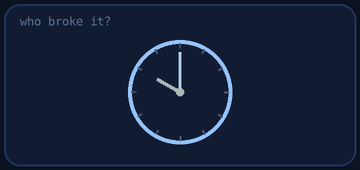
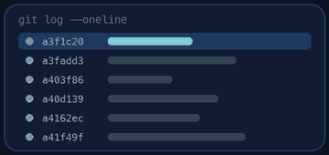
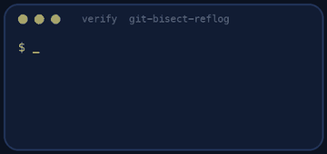
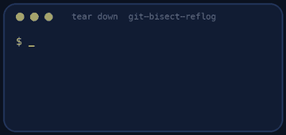

<p align="center"></p>

| | |
|-|-|
| **Time** | 45-60 min |
| **Cost** | free |
| **You need** | Git in your Ubuntu environment |

## How this lab works

1. **Fork** this repository to your own GitHub account (button at the top right).
2. Clone **your fork** in your Ubuntu environment (WSL on Windows, your OrbStack machine on Mac).
3. Read the lab below (the same text is in [`LAB.md`](LAB.md)) and follow the mission.
4. Answer the questions in [`SUBMISSION.md`](SUBMISSION.md). Where a question asks for output, paste it in a code block. No screenshots needed.
5. Commit and push. Open the **Actions** tab of your fork (click *I understand my workflows, go ahead and enable them* the first time). The **Lab check** shows what is still missing.
6. When the check is green, **submit the URL of your fork** in the course platform.

> [!NOTE]
> The check only looks at your answers and any files the lab asks you to commit. Your instructor reads your work and may ask you to explain any line.

<p align="center"></p>

## 🎬 The situation

<p align="center"></p>

```text
MISSION BRIEFING - Operation Green Build
Festival day : 40 food trucks print a Clippy QR code on their menu boards
Status       : the nightly tests are RED
Squad        : you, one release manager, two developers
Levels       : 3          Time limit : 45-60 minutes          Lives : unlimited (git remembers)
```

The nightly run was green last week. Since then, 40 commits landed from three people. The release manager's order: *"Find the commit that broke it. I am not reading 40 diffs."*

While you work, a developer calls in panic: *"I ran the wrong command and my premium-tier branch is empty. Three days of work!"* And before the festival opens, one small fix from `develop` must reach `release/1.0`, **without** the unfinished work next to it.

Three levels, one repository. Each level has a boss question at the end.

> [!IMPORTANT]
> **Your mission**
> - **Level 1:** find the guilty commit automatically with `git bisect`
> - **Level 2:** rescue three "lost" commits using the reflog
> - **Level 3:** move exactly one fix to the release branch with `git cherry-pick`

**Time:** 45-60 min | **Cost:** free | **You need:** Git and Python 3 in your Ubuntu environment

<p align="center"></p>

## Level 0 - Boot the game

Fork this repository, clone your fork, and run:

```bash
./setup.sh
```

You get `sandbox/clippy` with 40 commits on `main`, a `develop` branch and a `release/1.0` branch. Work in `sandbox/clippy` unless a level says otherwise.

Before you start, look around:

1. Run `./test.sh` and read the failure message carefully.
2. `git log --oneline` shows 40 commits. Skim the messages and **write your guess** for the guilty one. It is fine to be wrong, and it makes the next level funnier.
3. The first commit ("Clippy baseline with tests") was green. Confirm it: check it out in detached HEAD (`git switch --detach HEAD~39`), run the test, and come back (`git switch main`).

> [!NOTE]
> **Predict** If you tested commits one by one from newest to oldest you might need up to 39 runs. If you cut the history in half each time, how many runs do 40 commits need at most? Write a number. It is your bet for Level 1.

<p align="center"></p>

## Level 1 - Bisect: let Git search

<p align="center"></p>

Play it by hand first:

```bash
git bisect start
git bisect bad                    # the commit you are on is broken
git bisect good HEAD~39           # the baseline was fine
```

Git checks out a commit in the middle. Run `./test.sh` yourself, then tell Git `git bisect good` or `git bisect bad`. Repeat until Git prints "is the first bad commit". Count the steps and compare them with your bet.

Now the speed run, **fully automatic**, because the test already returns the right exit code:

```bash
git bisect reset
git bisect start HEAD HEAD~39
git bisect run ./test.sh
```

Save your score: run `git bisect log`, then write the **short hash** of the guilty commit into a file called `culprit.txt` in the **lab repo root** (not in the sandbox). Finish with `git bisect reset` to get back to `main`.

> [!NOTE]
> **Think** *Boss question.* Look at the guilty commit with `git show`. Its message says "readability". What does that tell you about trusting commit messages, and what would have caught the bug before it reached `main`?

<p align="center"></p>

## Level 2 - Rescue: the work that "vanished"

In the **lab repo** (not the sandbox), run:

```bash
./oops.sh
```

It creates a branch `premium` with three commits, then runs `git reset --hard main` on it. Go to the sandbox and look: `git log --oneline premium` shows nothing special. The work is "gone".

1. `git reflog` shows where `HEAD` has been. Also try `git reflog show premium`. Find the entry from **before** the reset.
2. Create a new branch called `rescued` pointing at the last of the three lost commits.
3. Check that all three "Add premium tier" commits are on `rescued`.

> [!WARNING]
> **Break it** *Boss question.* Git eventually deletes unreachable commits (`git gc`). Look up how long the reflog keeps entries by default (`git help gc`, search "gc.reflogExpire"). What does that tell you about how fast you must react?

<p align="center"></p>

## Level 3 - Cherry-pick: one fix, nothing else

On `develop` the whitespace fix sits between two "WIP: ... do not release" commits. A merge of `develop` would ship the unfinished work to forty food trucks.

1. Find the fix: `git log --oneline develop`.
2. Switch to `release/1.0` and **cherry-pick** only that commit. Add `-x` so the new commit records where it came from.
3. Compare the hashes of the original and the copy. Why are they different?

> [!NOTE]
> **Think** *Boss question.* A half-finished edit is sitting in your working tree when the request arrives (imagine one). Which command parks it safely so you can switch branches, and which brings it back?

<p align="center"></p>

## Final boss - Prove it

<p align="center"></p>

```bash
./verify.sh
```

All checks green means the festival opens on time.

<p align="center"></p>

## Level up (optional)

- **Skip a commit.** Run bisect again and use `git bisect skip` when a commit cannot be tested.
- **blame.** On the guilty file run `git blame shorten.py`. Compare with what bisect told you.
- **Revert.** Fix the bug on a new branch with `git revert <guilty-commit>` instead of editing the file. When is revert better than a manual fix?

<!-- teardown:start (generated by labs.py, do not edit) -->
## Tear down (mandatory)

<p align="center"></p>

Resources left behind cost money, keep doors open and pollute the next lab. Removing what you created is part of the job, so it is part of the submission: **you must prove it is gone**.

Do this **last**, after you have pasted your `verify` output into `SUBMISSION.md` (once you tear down, the lab can no longer be verified).

1. Run `./teardown.sh`. It deletes the `sandbox/` repository (your `culprit.txt` stays).

Then run the proof:

```bash
./verify-teardown.sh
```

It prints a list of checks and must end with **TEARDOWN VERIFIED**. If it reports leftovers, remove them and run it again. Paste the full output in your submission.
<!-- teardown:end -->

<!-- submission:start (generated by labs.py, do not edit) -->
## 📬 Submission

Answer the questions in `SUBMISSION.md` in **your fork** (paste output in code blocks where asked), push, then submit the **URL of your fork**.

**Files to commit**

- `culprit.txt`: the short hash of the commit that broke the tests

**Questions to answer**

1. Paste your `git bisect` session log (`git bisect log`). How many steps did it take for 40 commits, and why is that number so small?
2. Which commit broke the tests, and what did it change? Why did the tests of the commits *before* it still pass?
3. You lost three commits with `git reset --hard`. Paste the `git reflog` lines that let you find them. How long does Git keep that safety net?
4. What is the difference between `git cherry-pick` and `git merge`? Why did the cherry-picked commit get a new hash?
5. Paste the output of `./verify.sh`. It must end with **ALL CHECKS PASSED**.
6. **Tear down.** Paste the output of `./verify-teardown.sh`. It must end with **TEARDOWN VERIFIED**.
<!-- submission:end -->
